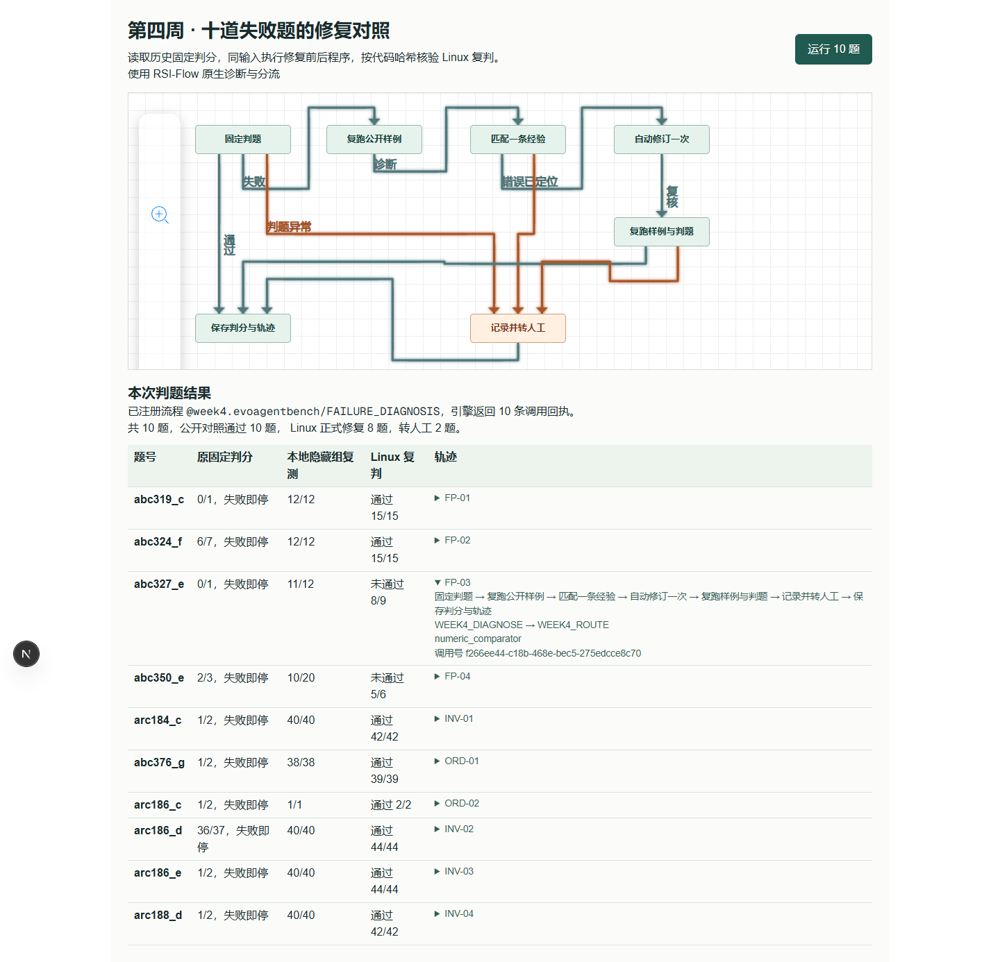

# RSI-Flow 原生 Skill 验收

从 rsi-flow-platform 的“运行 10 题”发起批次，原版 Spring 流程入口接收每道题的观测，RSI-Flow FlowEngine 调度 WEEK4_DIAGNOSE 和 WEEK4_ROUTE 两个已注册节点。十题取得十个不同的调用号，其中四题命中数值比较差异、三题命中公开样例差异、三题命中独立反例。第十一道保留题返回需要反例并转人工。十道冻结题的 Linux 判题为八题通过、两题失败。

- [源码与启动步骤](REPRODUCE.md)
- [十题原生调度回执](evidence/native-batch.json)
- [保留题的真实输入与转人工结果](evidence/native-holdout.json)
- [可直接重放的 HTTP 请求](evidence/native-example-request.json)
- [原生引擎调用日志](evidence/native-engine.log)

解压后阅读 week4-2/native/README.md。可运行 python native/verify.py 对归档证据进行离线核验。另有 Java 注册源码、流程 JSON、启动命令和真实接口复现步骤。本批选择在原“匹配经验”环节接入原生诊断与分流，公开程序复测由 Python 驱动，正式分数由固定 Linux 判题器提供。