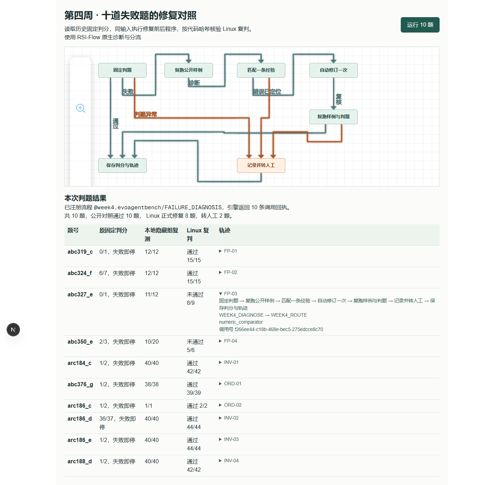

# 从失败轨迹到一次修订：EvoAgentBench 十题实验

第四周个人任务 4.2 · 2026 年 11 月 27 日 · 原生 Skill 调度版

**教学视频要求的注册与调度已实测。** 在负责人确认的“匹配经验”步骤中注册两个 RSI-Flow 原生节点。平台将每题的公开观测交给引擎，再依据引擎返回的分流结果决定是否修订。浏览器十题产生十个独立调用号；保留题另行调用同一流程，返回转人工。[注册代码、调度步骤与实测证据](NATIVE-SKILL.md)

**冻结的 10 道基线失败题中，8 道通过原版 Linux 固定判题，正式修复率为 80%。** 平台实际执行了 10 次候选修订和 10 次复核，两道小数输出题进入人工复核。每道题都有一个相同输入上的前后输出，打开[十题对照](cases.md)即可逐题核查。



## 1. 哪些问题算入本次实验

历史批次有 4 道正式失败，截断恢复批次有 7 道正常结束后正式失败，两批按题号去重后共 11 道。按原先已经冻结的前 10 道提交，后完成的 `abc382_g` 用于检验诊断规则。补跑通过的 `arc189_c`、未完成的生成和同一题的重复尝试均未进入失败计数。样本专门从失败中选取，80% 的分母仅为这十题。原始判分摘录保留了通过向量、来源结果和会话的 SHA-256。[登记清单](evidence/registry.json) · [原始轨迹及固定判分摘要](evidence/baseline-receipts.json)

| 题号 | 历史固定判分 | 修订后 Linux 固定判分 | 本地逐组精确复测 |
|---|---:|---:|---:|
| [abc319_c](cases.md#abc319-c) | 0/1 | 15/15，通过 | 15/15 |
| [abc324_f](cases.md#abc324-f) | 6/7 | 15/15，通过 | 15/15 |
| [abc327_e](cases.md#abc327-e) | 0/1 | 8/9，失败 | 14/15 |
| [abc350_e](cases.md#abc350-e) | 2/3 | 5/6，失败 | 13/23 |
| [arc184_c](cases.md#arc184-c) | 1/2 | 42/42，通过 | 42/42 |
| [abc376_g](cases.md#abc376-g) | 1/2 | 39/39，通过 | 39/39 |
| [arc186_c](cases.md#arc186-c) | 1/2 | 2/2，通过 | 2/2 |
| [arc186_d](cases.md#arc186-d) | 36/37 | 44/44，通过 | 44/44 |
| [arc186_e](cases.md#arc186-e) | 1/2 | 44/44，通过 | 44/44 |
| [arc188_d](cases.md#arc188-d) | 1/2 | 42/42，通过 | 42/42 |

固定判题在首个失败测试组停止。例如 `arc186_d` 的基线通过 36 组，在第 37 组失败；修订版运行到最后，通过全部 44 组。最后一列独立运行全部组，便于看到首个错误之后的表现。

## 2. 人工决定的结构，以及经验怎样进入下一步

本次沿用并由任务负责人确认的结构为固定判题 → 复跑公开样例 → 匹配一条经验 → 修订一次 → 再判题。复判失败、没有依据或判题环境异常时，走转人工分支。一次修订的预算让每条经验都能对应一个明确的修订结果，也保留了失败后的分析材料。[画布定义](platform/workflow.json) · [本次逐节点轨迹](evidence/platform-batch.json)

1. **定位。** 先读取与代码哈希绑定的历史固定判分，再运行基线代码。若公开样例已经通过，就用题意构造可手算、可公开的反例。`abc376_g` 的三个节点展示了贪心错误：先取当前最重节点会延后高权重子节点，最优加权和应为 25。
2. **存储。** 每条经验记录触发症状、修订动作、可迁移条件和来源。公开输入、期望输出、实际输出、代码哈希和正式判分分别保存。较早平台批次的两条原始经验也一并保留。[本次经验卡](recipes.json) · [原始经验](platform/experiences.json)
3. **调用。** 平台要求基线在公开对照中留下具体差异，并核验修订代码的哈希，再把与该题绑定的候选交给复核。比如 `arc186_d` 只调整终止条件；`arc186_e` 则按目标中相邻字符是否相同拆分状态。两题都在原判题的全部 44 组上通过。
4. **检验。** 页面实际发出运行请求，执行器重跑前后程序、完整复测修订候选，并按数据及代码哈希接入同一 Linux 判题器的回执。公开的 26 个样例和 4 个反例均有配对记录。正式成功标准为冻结数据集上 `reward = 1`。[公开对照](evidence/public-pairs.json) · [Linux 回执](evidence/official-after.json) · [本地全量记录](evidence/local-full.json)

自动化部分包括重放、应用事先准备的候选、判分核验与转人工。具体算法修订由 AI 辅助准备，其中六道整数题查阅了 AtCoder 官方题解。实验验证了这些候选的修复效果；经验文本单独贡献了多少，尚缺少随机对照实验。

## 3. 失败分析与迁移

- **`abc327_e`。** 递推求分母修复了全部公开样例。Linux 仍在第 9 组报输出不一致。本地精确比较通过 14/15 组，按题面绝对或相对误差不超过 10⁻⁶ 的规则通过 15/15 组。[原题](https://atcoder.jp/contests/abc327/tasks/abc327_e)
- **`abc350_e`。** 消去掷出 1 的自环后，以高精度计算期望，公开第三例得到参考值 6418410657.7408381。Linux 在第 6 组报输出不一致。本地精确比较通过 13/23 组，按题面同一容差通过 23/23 组。流程保留这两项正式失败，停止追加试探。[原题](https://atcoder.jp/contests/abc350/tasks/abc350_e)
- **跨题复用。** 同一段诊断逻辑在四道数值题上标记了比较规则差异。把仅依据可观测输出工作的诊断逻辑用于保留题 `abc382_g`，其公开样例均通过，规则给出“需构造反例”，流程未声称修复。这项验证只覆盖诊断分流。算法候选仍然按题准备。[诊断程序](diagnose.py) · [留出题实测](evidence/transfer.json)

本地完整复测按精确数值比较通过 270/281 组，以题面容差核验浮点题后通过 281/281 组。已有基线也有符合题面容差的输出，281/281 只描述修订结果。较早的 23 题平台运行包含 19 道原本就通过的题，另外 4 道转人工，正式修复 0 道。这份较早记录单独存档。[历史平台运行](platform/platform-run.json)

## 4. 下一阶段怎样衡量人工干预

本批可观测的量为 **10 道正式判分均已取得，8 道通过，2 次转人工**。日志只记录路由；每题候选准备和人工思考所花的次数未采集。下一轮先记录每次人工改变诊断、候选或流程的事件，以“实际人工决定总数 ÷ 有正式终态的题数”为指标，同时报告每道题的人工分钟数和修复率。

下一次在同一数据集另取一批事先冻结的问题，先后或交叉运行当前流程及自动生成候选的流程。保持模型、可用公开信息、一次修订预算和判题器一致。第一道验收门槛是 100% 题目取得正式终态；另行报告能否达到 100% 正式修复。随后比较人工决定次数，目标由实测基线 H 减至不超过 H/2，正式修复率不下降。转人工的辅助目标由本批 2/10 减至不超过 1/10。以上是下一轮待验证的目标。

## 5. 复现与分工

从本目录运行以下命令，需要 Python 3.10 或以上。第一条使用仓库内的公开样例及 4 个反例，第二条重新运行保留题诊断。

```sh
python replay.py --output public-replay.json
python diagnose.py
```

全量复核使用三个冻结的数据文件，文件身份由 [登记清单](evidence/registry.json) 的 SHA-256 校验。按历史实验分别使用 pilot 的 `selected-test-tasks.json`、heldout-9 的同名文件和 six-new-failures 的 `tasks.json`。只将隐藏输入经标准输入交给待测程序，参考输出留在判题端。仓库只收录隐藏输入的摘要与通过标记。

没有原实验目录时，可从固定版本下载发布的 JSONL 分片，按下面的命令重建三份文件。脚本按原题号顺序序列化，并逐份比对历史文件的 SHA-256；三个文件均已通过字节级还原测试。[固定版数据集](https://huggingface.co/datasets/livecodebench/code_generation_lite/tree/0fe84c3912ea0c4d4a78037083943e8f0c4dd505) · [冻结题号与哈希](evidence/cohorts.json)

```sh
python restore_data.py --shard test.jsonl --shard test2.jsonl --shard test3.jsonl --shard test4.jsonl --shard test5.jsonl --shard test6.jsonl --output restored
```

下列命令中，`PILOT`、`HELDOUT`、`RECOVERY_SOURCE` 可分别替换为 `restored/pilot.json`、`restored/heldout.json` 和 `restored/recovery-source.json`。

```sh
python replay.py --dataset PILOT --dataset HELDOUT --dataset RECOVERY_SOURCE --side after --output local-full.json
python official.py --lcb LIVE_CODE_BENCH_CHECKOUT --dataset PILOT --dataset HELDOUT --dataset RECOVERY_SOURCE
python batch_service.py --dataset PILOT --dataset HELDOUT --dataset RECOVERY_SOURCE
```

Linux 检出版本为 `28fef95ea8c9f7a547c8329f2cd3d32b92c1fa24`，原镜像为 `pi-lcb-submission:py312`。每组限时 6 秒，容器限 2 CPU、2 GiB 内存，关闭网络。镜像 ID 记录在正式回执中。平台复现时将 [context-repair 页面目录](platform/app/context-repair) 放入原 rsi-flow-platform 的 `app` 目录，启动上述执行器和平台开发服务，访问 `/context-repair/batch` 并点击“运行 10 题”。仅复现公开部分时，直接运行 `python batch_service.py`。

负责人确认沿用已有图结构、选择目标仓库，并在本机启动正式判题。AI 协助提取运行记录、准备反例和修订实现、接入平台、复测和整理报告。题面与题解链接按题列在对照页。提交时可在[表单文案](submission.txt)中核对本人工作和 AI 分工。
